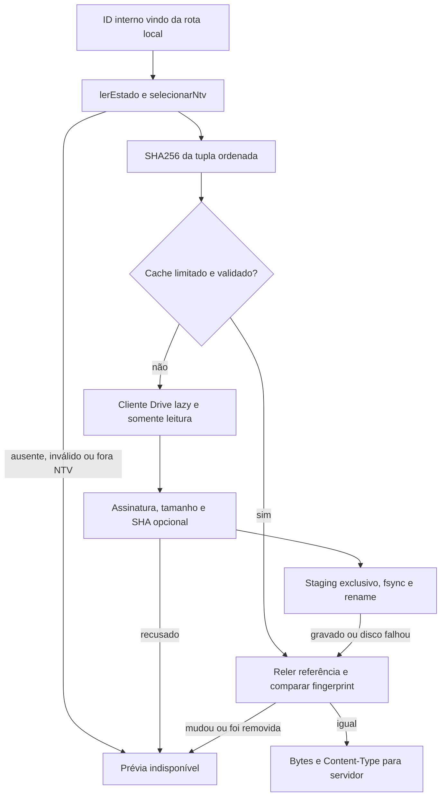

# Prévias de imagens, vídeos e cache local

Como uma folha de contato ao lado de cada texto, a prévia ajuda a reconhecer imagens e vídeos já registrados. A captura continua sendo a etiqueta que autoriza a leitura; o cache guarda somente bytes conferidos e não cria estado editorial.

A 007 acrescenta MP4 de até 64.000.000 bytes por `obterVideo`, implementado/testado localmente em 15/10/2026, sem integração Git. Imagens conservam o contrato de 15.000.000 bytes. [Contrato de vídeo](../../specs/007-previas-videos/contracts/video.md) e [validação](../../specs/007-previas-videos/validacao.md); os números da 005 abaixo são históricos.

Implementado/testado localmente na 005, no [PR #23](https://github.com/Browsher/crm-social/pull/23); merge/exclusão da branch autorizados após gate/review aprovados no head final. Fonte do código/testes/PNGs e gate: `452197514b8d10a14bcc466e8bc83bfdfb601e95`, gate Windows 578 PASS, sem pulos locais, e cobertura 95,0881%. [Validação por rodada](../../specs/005-previas-imagens/validacao.md) preserva os gates e screenshots anteriores; os 12 PNG atuais são dessa fonte. Código: [src/midia.cjs](../../src/midia.cjs); contrato público: [contracts/midia.md](../../specs/005-previas-imagens/contracts/midia.md). T002 confirmada pelo autor em 08/10/2026: pasta Produções compartilhada com a conta de serviço como Leitor. Sem teste de acesso real pelo agente; os fakes não comprovam acesso operacional.

## Interfaces e dependências

| Export / entrada | Comportamento real |
| --- | --- |
| `validarImagem(bytes,sha256)` | Buffer até 15.000.000 bytes, assinatura PNG/JPEG/WEBP e SHA opcional; retorna MIME ou erro422 constante |
| `validarVideo(bytes,sha256)` | Buffer MP4 até 64.000.000 bytes, caixas e marca compatível mínimas, SHA opcional; retorna `video/mp4` ou erro422 constante |
| `resolverArquivo(estado,arquivoId)` | Recorte NTV por triagem, ID interno exato e único, versão positiva segura, id_drive canônico e SHA normalizado |
| `criarServicoMidia({dataDir,criarCliente}).obter(arquivoId)` | Resolve snapshot vigente, cache/download validado, fingerprint final; retorna `{bytes,contentType}` |
| `criarServicoMidia({dataDir,criarCliente}).obterVideo(arquivoId)` | Mesmo ciclo para arquivo `tipo=video`, produção NTV unívoca, chave de cache separada e limite de 64 MB |
| `dataDir` | Caminho confiável do servidor, padrão data/; navegador não o escolhe |
| `criarCliente` | Factory privada, padrão criarClienteDrive; instanciada no primeiro miss, injetável nos testes |

Imports locais reais: [snapshot](snapshot.md) (`lerEstado`), [triagem](triagem.md) (`selecionarNtv`) e [Google](google.md) (`criarClienteDrive`). APIs nativas: crypto, fs e path. [Servidor](servidor.md) importa o módulo para a rota GET /api/midia/ID-interno; não há dependência nova de aplicação ou ciclo novo.

## Resolução e validação

Cada pedido começa com `referenciaAtual`: snapshot válido e recorte NTV, sem fallback por URL/nome. `arquivo_id` exato ausente/fora do recorte dá404; captura/recibo ilegível dá503. Registro exige versão inteira positiva segura, id_drive preenchido com `A–Z`, `a–z`, `0–9`, `_`, `-`, e SHA vazio ou 64 hex. Registro recusado dá422 antes de cliente/rede. Duplicidade detectada no resolver puro dá422; duplicidade já recusada pelo parser do snapshot dá503.

Bytes, e não MIME/extensão/tipo declarados, decidem o conteúdo. PNG exige oito bytes completos; JPEG `FF D8 FF`; WEBP os bytes exatos de `RIFF` e `WEBP`, em pelo menos 12 bytes. SVG/GIF/vídeo/ZIP/HTML/JSON e truncados são recusados. Até **15.000.000 bytes inclusive**; SHA preenchido exige SHA-256 igual, sem diferença de caixa na representação hex. A validação é mínima de assinatura, sem decodificação integral: o fallback `img.onerror` da [interface](web.md#prévias-de-imagens--005) cobre bytes indecodificáveis.

## MP4 — 007

`resolverVideo` reutiliza `resolverArquivo`, exige `tipo=video`, identidade de arquivo única na captura inteira e uma única produção correspondente, da NTV. Não escolhe o vídeo final: esse vínculo de apresentação pertence a `layout-model.videoDaPeca`. A rota não aceita URL, caminho nem ID Drive arbitrário.

`validarVideo` exige Buffer de 24 a 64.000.000 bytes inclusive. A primeira caixa precisa ser `ftyp` com header comum e estrutura de marcas válida; aceita uma das marcas `isom`, `iso2`, `avc1`, `mp41`, `mp42`. Depois percorre caixas completas, sem ultrapassar o Buffer, com tamanhos comuns, estendidos seguros ou zero até o fim; exige `moov` e `mdat` com conteúdo. SHA preenchido é reconferido. Assinatura isolada, caixas truncadas, HTML e imagens não passam. Isso não decodifica trilhas/codecs: o navegador ainda pode recusar o conteúdo e apresentar indisponibilidade.

`obterVideo` solicita `cliente.getMidia(id_drive,{maxBytes:64_000_000})`; imagem mantém o padrão de 15 MB. O arquivo completo é validado antes de responder qualquer faixa. Não há transcodificação, extração ZIP ou leitura automática de diretório de vídeos.

## Cache e concorrência

`chaveArquivo` calcula SHA-256 de `JSON.stringify([arquivo_id,versao,id_drive,sha256Normalizado])`. O nome é hexadecimal sob `data/midias/<chave>.bin`, nunca o ID ou caminho da requisição. Cache é privado e ignorado por Git. Mudança de ID, versão, referência remota ou SHA muda a chave; caixa diferente do mesmo SHA não muda.

Para vídeo, a tupla acrescenta `'video', tipo, producao_id`. Assim bytes de imagem não compartilham autorização com vídeo mesmo sem SHA. As mesmas regras de diretório, descritor, staging, coalescência e reconferência final abaixo valem para os dois tipos, com limite de leitura próprio.

`lerLimitado` lê no máximo limite+1, em blocos de até 64 KiB. Antes dos bytes, exige arquivo regular no `lstatSync` e no `fstatSync` do descritor aberto, com `dev` e `ino` bigint iguais. Troca entre a conferência do caminho e a abertura recusa o hit e causa refetch; o descritor fecha em `finally`. Cache hit reconfere MIME/tamanho/hash. Diretório de cache precisa ser diretório sem symlink. Corrupção, excesso, parcial ou erro de leitura viram miss/refetch; não concedem autorização sem snapshot válido.

`promoverCache` cria staging exclusivo por UUID, escreve/fsync/fecha e promove por rename. Limpa somente seu próprio staging. Falha de mkdir/escrita/promoção pode servir os bytes novos já validados sem persistência; não muda captura, recibos, aprovação ou publicação. Promessas da mesma chave coalescem download e são removidas ao finalizar, inclusive na falha; não há Buffer global permanente. Cada chamador reconfere a referência após cache/download: alteração, remoção ou estado inválido gera503, impedindo servir a referência anterior como atual. Captura nova com a mesma referência permite resposta. Isso exige duas leituras síncronas integrais da captura por prévia, inclusive no hit, por `lerEstado` antes e depois dos bytes.

## Fronteira pública, testes e limites

O serviço devolve somente bytes/contentType ou `Error('Prévia indisponível')` com status404/422/503. O adaptador HTTP aplica origem/método/forma, headers e demais status do contrato. Nenhum ID remoto, e-mail, mensagem Google ou caminho acompanha falhas. O cliente lê Drive somente no servidor; as permissões dependem da pasta compartilhada pelo autor.

[tests/midia.test.cjs](../../tests/midia.test.cjs) importa e exercita o módulo explicitamente: 31 casos de regras, TEMP real, hits/misses, corrupção, falha de disco/staging, concorrência, fingerprint e troca determinística do arquivo entre lstat/open sem SHA. Essa regressão observou RED antes da correção e confirmou refetch correto, fechamento do descritor e captura preservada no GREEN. [HTTP real](../../tests/midia-http.test.cjs) cobre a composição até o cliente nativo com transporte falso; [UI](../../tests/previas-interface.test.cjs) cobre demanda, galeria, fallback e foco. As cinco camadas passaram no gate local registrado; UI fica fora do LCOV e CI Linux conserva seus pulos explícitos.

Sem SHA declarado, referência ou identidade do descritor iguais não provam imutabilidade do conteúdo local/remoto. Não há eviction, quota, limpeza automática ou agenda de revalidação; entradas antigas podem permanecer. O cache herda as permissões/ACL de `data/`, sem aplicar ACL ou modo privativo próprios. Não há transcodificação, extração/manifesto ZIP ou nova inferência editorial. Cache continua removível localmente sem alterar a captura; testes sintéticos não demonstram compartilhamento ou acesso operacional real. O cliente não envia `supportsAllDrives`; [limite de Shared drives e T002](google.md#leitura-de-imagens--005).

[tests/video.test.cjs](../../tests/video.test.cjs) acrescenta validação MP4, limites inclusivos, tipo/identidade, cache TEMP, corrupção, concorrência, referência removida/alterada e separação de imagem/vídeo. Na demonstração privada da 007, a tentativa remota retornou 503; bytes dos arquivos locais autorizados foram validados e preparados no cache. Nenhum código ou ambiente ganhou fallback a caminho local. Perder/remover esse cache exige acesso ao Drive no próximo miss; não atribuir reprodução do cache a download remoto bem-sucedido.
