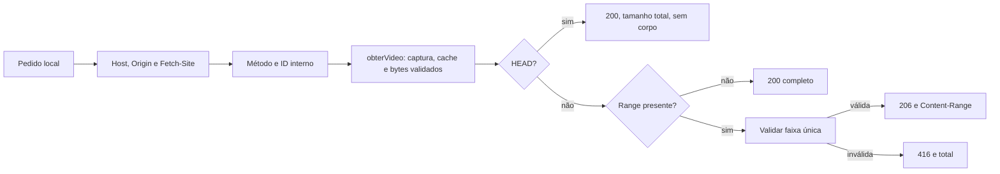

# HTTP de vídeo local

Como entregar somente o trecho pedido de um filme já conferido, este adaptador permite ao navegador reproduzir e buscar posições no MP4. A autorização continua vindo da captura vigente; a rota não aceita um endereço de download escolhido pelo cliente.

[src/video-http.cjs](../../src/video-http.cjs) foi acrescentado na 007, implementada/testada localmente em 15/10/2026, sem integração Git. Não possui imports. Exporta `getVideo(req,res,{permitida,servico,enviar})`; [servidor](servidor.md) injeta a guarda local, a factory do [serviço de mídia](midia.md) e o emissor de respostas. [Contrato](../../specs/007-previas-videos/contracts/video.md) e [validação](../../specs/007-previas-videos/validacao.md).

| Entrada / resposta | Comportamento |
| --- | --- |
| `GET /api/video/<arquivo_id>` | Resolve MP4 completo pelo ID interno e responde 200, `Content-Type: video/mp4`, `Content-Length` total e `Accept-Ranges: bytes` |
| `GET` com `Range: bytes=inicio-fim` | 206; fim maior que o total é limitado ao último byte |
| `GET` com `Range: bytes=inicio-` | 206 do início ao último byte |
| `GET` com `Range: bytes=-sufixo` | 206 dos últimos N bytes, limitado ao tamanho total |
| `HEAD` | Mesmos controles e comprimento total, sem corpo; ignora Range, inclusive inválido |
| Range vazio/múltiplo/malformado/fora do tamanho | 416 com `Content-Range: bytes */<total>`; números sem precisão segura também são recusados |
| ID/forma inválidos | 400; decodifica uma vez e recusa vazio, `.`, `..`, query/fragmento, barras, dois-pontos e controles |
| Origem recusada | 403 antes de consultar serviço; mesma guarda Host/Origin e recusa Fetch-Site `cross-site`/`same-site` |
| Método diferente de GET/HEAD | 405 com `Allow: GET, HEAD`, sem consultar serviço |
| Serviço sem registro / inválido / indisponível | 404/422/503; erro inesperado vira 503 |

Toda falha contém apenas **Prévia indisponível**, com comprimento UTF-8 correto e sem corpo em HEAD. Sucesso e falha recebem `Cross-Origin-Resource-Policy: same-origin`; o emissor comum inclui `Cache-Control: no-store`, `nosniff` e CSP, com `media-src 'self'`. Não há CORS externo.

O limite de **64.000.000 bytes**, validação estrutural MP4/SHA e referência antes/depois pertencem a `midia.cjs`; este adaptador recorta o Buffer já autorizado. Até HEAD e faixas inválidas obtêm/validam o arquivo antes de responder. Não há transmissão progressiva do Drive, múltiplas faixas ou transcodificação. Um arquivo com estrutura MP4 aceita ainda depende do codec suportado pelo navegador; erro do player mostra indisponibilidade sem alterar a peça.

[tests/video-http.test.cjs](../../tests/video-http.test.cjs) exercita HTTP real em porta efêmera, comprimento, faixas fechadas/abertas/sufixo, HEAD, guardas, ID, erros sanitizados e captura preservada. Os bytes são sintéticos; [tests/video-interface.test.cjs](../../tests/video-interface.test.cjs) demonstra reprodução/busca/tela cheia no navegador. Nenhum teste versionado usa mídia ou credencial operacional.
